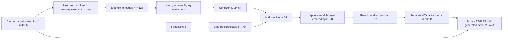

# Current generator architecture and tensor axes

This describes the original-pipeline v3 continuation implementation at revision
`2ea51dee6bfb02394ad2990e56f5d66a4b11da80`. Dimensions were checked against the pinned
step-4000 parent bundle and current source, not inferred from the loss screenshot.
[Machine-readable dimensions and parameter counts](results/benchmarks/2026-10-28-original-feedback-v3/architecture.json)
retain parent/model identities. For observations see
[GEN-007](results/GEN-007-original-feedback-v3.md); for commands see
[the v3 runbook](eagle3_original_pipeline_continuation_v3.md).

## Axes and components

| Symbol | Meaning | Current value/range |
| --- | --- | --- |
| N | Conditioning examples in one cohort | 1–8 in training; 4 in validation, with a short tail |
| L_i | Saved prompt-plus-response length of example i | Variable |
| p_i | Original prompt length | Variable, positive |
| T | Packed shifted-token positions in one drafter microbatch | Up to 8192, padded to a multiple of 128 for FlexAttention |
| d | Target/drafter hidden width | 4096 |
| r | Generated LoRA rank | 32 |
| V_d | Pretrained draft vocabulary | 32000 |
| V_t | Target vocabulary/token-embedding vocabulary | 151936 |

There are three components: a frozen Qwen3-8B target supplying cached activations,
a frozen one-layer EAGLE3 drafter, and a trainable hypernetwork that emits the
drafter's LoRA factors. The approximately 293M parameter count refers to the
hypernetwork only, excluding the target and frozen drafter.



## Target states and prompt summary

Each saved example has cached target states `[L_i, 4, 4096]`. The configured slots
are auxiliary target layer IDs 2, 18 and 33, followed by last-layer ID 36. The last
slot supplies teacher logits for loss; it is not included in generator summaries.

For example i, select the **last prompt token**, before the saved response:

```python
summary_i = states[p_i - 1, :3, :].flatten()  # [12288]
summaries = stack(summary_i for i in cohort)  # [N, 12288]
lengths = tensor(prompt_lengths)             # [N]
```

The generator sees one vector per prompt, not `[N, prompt_length, hidden]`. There
is no learned attention over all prompt tokens in this hypernetwork. The last
target states already encode preceding prompt context through the frozen target.

## Example encoder and permutation-invariant pooling

| Operation | Shape |
| --- | --- |
| Append log(1+p_i) to each summary | `[N, 12289]` |
| Linear(12289, 512), GELU | `[N, 512]` |
| Linear(512, 128), LayerNorm(128) | `[N, 128]` |
| Mean over example axis 0 | `[128]` |
| Population standard deviation over axis 0 | `[128]` |
| Concatenate mean, std, log(1+N) | `[257]` |
| Linear(257, 128), GELU, Linear(128, 64) | `[64]` |

This is a Deep-Sets-style permutation-invariant encoder. Pooling treats the
conditioning examples as a set. Standard deviation uses `correction=0`, so N=1
has zero spread rather than an undefined sample deviation.

**N is reduced away. One generator call emits one shared adapter for the entire
conditioning cohort, not N independent adapters.** Four such episodes accumulate
gradients before an optimizer update. Those four episodes, N, and token axis T
are different notions of batch size.

## Feedback injection

The regular arm has no feedback projection. The feedback arm adds only:

```python
self.feedback_encoder = nn.Linear(3, 64, bias=False)
nn.init.zeros_(self.feedback_encoder.weight)  # [64, 3], 192 parameters

c = self.condition(pooled)                   # [64]
c = c + self.feedback_encoder(feedback)      # [64] + [64]
```

The signal is `[latest_ratio, EMA, observed_flag]`, shape `[3]`. It is additive
conditioning of the common decoder input; there is no multiplicative gate,
per-layer feedback network, token/rejection embedding, or learned scale controller.
Zero initialization preserves the parent generator's initial factors. It does
not freeze this path: the whole generator and projector are trainable in v3.
Only the newly added projector starts at zero; the original generator weights
come from the trained step-4000 checkpoint.

At fixed prompt context, the feedback offset is a linear combination of the
projector's three learned columns: it occupies at most a three-dimensional
subspace of the 64-dimensional condition. The subsequent decoder is nonlinear,
so changes to the final A/B factors are not constrained to be linear in feedback.
The EMA is the only explicit feedback memory; there is no recurrent feedback
encoder or token-level feedback sequence.

The ratio is measured from existing cumulative-correct TTT counts divided by
eligible draft-slot counts on a completed **teacher-forced saved-prefix part**.
The signal is detached; gradients do not pass through argmax decisions or the
feedback statistic. Training observations retain the original augmentation/dropout.

| Supervised part of packed microbatch | Feedback used to generate its adapter |
| --- | --- |
| First up-to-64 active response positions | `[0, 0, 0]` |
| Next up-to-64 active response positions | `[a1, a1, 1]` |
| All remaining active response positions | `[a2, 0.9*a1 + 0.1*a2, 1]` |

These boundaries count supervised response positions, excluding prompt/padding.
Feedback resets per **packed microbatch**; a packed microbatch can contain several
responses. The signal is shared over its current part, not a distinct vector per
token or independent request. Cohort prompt summaries/lengths remain fixed.

For long sequences, the entire tail after the first 128 supervised positions uses
one feedback-conditioned adapter. There is no further refresh within that tail
and no new target rollout. This is a coarse training proxy, distinct from actual
serving acceptance reported after verifier passes.

## Factor decoder and LoRA dimensions

For each of the two target projections, concatenate:

```text
condition [64] + module embedding [32] + layer embedding [32] = descriptor [128]
```

The module embedding table is `[2, 32]` (V and O); the layer embedding table is
`[1, 32]` because this drafter has one decoder layer. The shared decoder applies
Linear(128, 512), GELU, then two residual MLP blocks. Each residual block is
`x + Linear(GELU(Linear(LayerNorm(x))))`, with both linears 512→512.

Each projection has separate A and B output heads, applied to its `[512]` decoded
descriptor. Each head is a large learned linear map from 512 to a flattened factor.

| Projection | Frozen W `[out, in]` | Generated A `[r, in]` | Generated B `[out, r]` | Factor elements |
| --- | --- | --- | --- | ---: |
| `v_proj` | `[1024, 8192]` | `[32, 8192]` | `[1024, 32]` | 294912 |
| `o_proj` | `[4096, 4096]` | `[32, 4096]` | `[4096, 32]` | 262144 |
| Total | | | | 557056 |

For row-major activations the injection is:

```text
Y = X Wᵀ + (64 / 32) Dropout(X) Aᵀ Bᵀ
  = X Wᵀ + 2 Dropout(X) Aᵀ Bᵀ
```

LoRA dropout is 0.05 in training, disabled in evaluation. Scale 2 is fixed in these
configs; feedback changes generated factors, not that coefficient. The factors
are produced as float32 tensors, with autocast handling frozen drafter compute.
The 557056 factor elements occupy 2.125 MiB at float32 per generated adapter.

| Hypernetwork component | Learned parameters |
| --- | ---: |
| Example encoder | 6358400 |
| Set-condition MLP | 41280 |
| Module/layer embeddings | 96 |
| Shared residual decoder | 1118720 |
| Four factor output heads | 285769728 |
| Regular generator total | 293288224 |
| Feedback projector addition | 192 |
| Feedback generator total | 293288416 |

About 97.4% of hypernetwork parameters are in its factor output heads. This is a
large hypernetwork generating relatively small low-rank adapters, with a common
64-dimensional condition. No saved LoRA bank, factor lookup, or reconstruction
target is involved in these continuation arms.

## Frozen EAGLE3 and token axes

Examples are shifted and packed by the original pipeline. T counts packed token
positions after dropping one position/example for alignment, with padding.
`document_ids` prevents attention between packed examples.

| Tensor/operation | Shape |
| --- | --- |
| Auxiliary target inputs | `[1, T, 12288]` |
| Teacher last-layer inputs | `[1, T, 4096]` |
| Token IDs, positions, document IDs, loss mask | `[1, T]` each |
| Frozen auxiliary FC, 12288→4096 | `[1, T, 4096]` |
| Frozen token embeddings | `[1, T, 4096]` |
| Concatenate token embedding and current hidden state | `[1, T, 8192]` |
| Q projection / reshape | `[1, 32, T, 128]` |
| K/V projections / reshape, each | `[1, 8, T, 128]` |
| Grouped-query attention output before O | `[1, T, 4096]` |
| O projection, residual, normalization, gated MLP | `[1, T, 4096]` |
| Frozen draft vocabulary head | `[1, T, 32000]` |
| Frozen teacher head restricted to draft vocabulary | `[1, T, 32000]` |

The leading `1` is a physical packed-batch axis; it does not mean only one saved
example is present. The EAGLE3 first layer uses separate normalization for token
embeddings and hidden state before concatenation. Q/K/V accept doubled width
8192; V emits 8×128=1024 channels, explaining its non-square LoRA. Attention uses
32 query heads and 8 KV heads (GQA), RoPE, residual connections, RMSNorm, and a
SiLU-gated MLP with intermediate width 12288.

Only V and O are adapted. Q/K, input fusion FC, MLP, token embeddings and heads
remain frozen. The target has vocabulary 151936, but the pretrained drafter and
teacher loss head use its fixed 32000-token subset. Loss probabilities normalize
over that subset; offline agreement is not full-vocabulary serving acceptance.

## Objective and gradient path

The original EAGLE3 forward executes three teacher-forced prediction depths
(TTT steps 0, 1, 2). Saved tokens supply the next inputs; the model does not create
a new training response. Logits are `[1, T, 32000]` at each depth, aligned to
`[1, T-s, 32000]` for depth s. `loss_0`, `loss_1`, `loss_2` in the screenshot are
those three depths. The training scalar sums their losses with decay 1.0 and
response-mask normalization; it is not directly comparable to only `loss_0`.

The implemented hybrid LK objective is:

```text
p = softmax(teacher_logits), q = softmax(draft_logits)
overlap = sum_v min(p_v, q_v)
lambda = exp(-3 * stop_gradient(overlap))
loss = lambda * KL(p || q) + (1 - lambda) * (1 - overlap)
```

In the feedback arm, disjoint part losses retain each original full-response
denominator. Every response label remains supervised; prefix masks do not discard
the tail. Auxiliary features receive original uniform noise in [-0.05, 0.05]
during training. Validation disables this augmentation and dropout.

Gradients travel through frozen drafter computations into A/B, then into the
hypernetwork. Adapter-leaf gradient accumulation is explicitly propagated back
through the generator; it does not sever generator learning. Target/drafter
parameters are not optimized. Parent Adam/RNG state is restored for generator
parameters; the new projector gets fresh slots. Both arms use LR 1e-4, weight decay
0.01, gradient clipping 0.85 and no restarted warmup.

## What the observed feedback result establishes

[GEN-007](results/GEN-007-original-feedback-v3.md) records no clear validation-loss
advantage through step 500 for this particular three-scalar, additive, coarse
saved-prefix feedback scheme. The plot does not establish that the projector
stayed zero, that factors ignore the signal, or that all feedback designs fail.
Those claims would require the missing projector/factor diagnostics and further
measurements; no architecture or training change is made by this document.

## Implementation references

- [Generator, pooling, heads and injection](../../src/speculators/generator/model.py).
- [Current feedback regions, ratios and normalization](../../src/speculators/generator/saved_response_feedback.py).
- [Original training update](../../src/speculators/generator/campaign_train.py).
- [EAGLE3 forward and teacher forcing](../../src/speculators/models/eagle3/core.py).
- [First-layer doubled-width attention](../../src/speculators/models/eagle3/model_definitions.py).
- [Hybrid LK formula](../../src/speculators/losses/eager.py).
