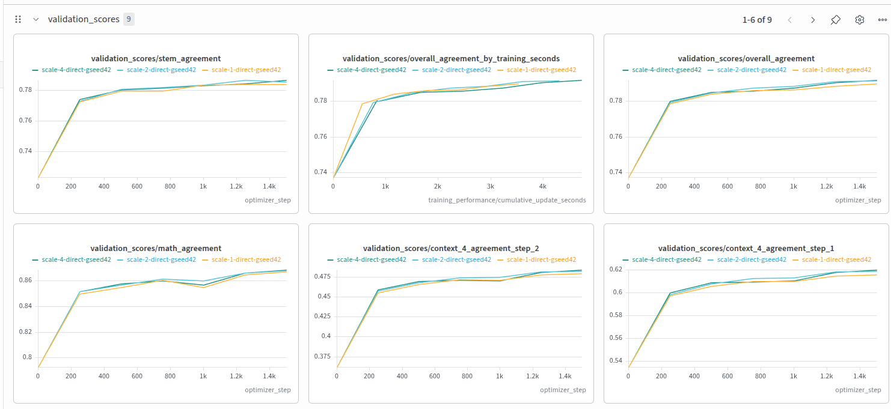
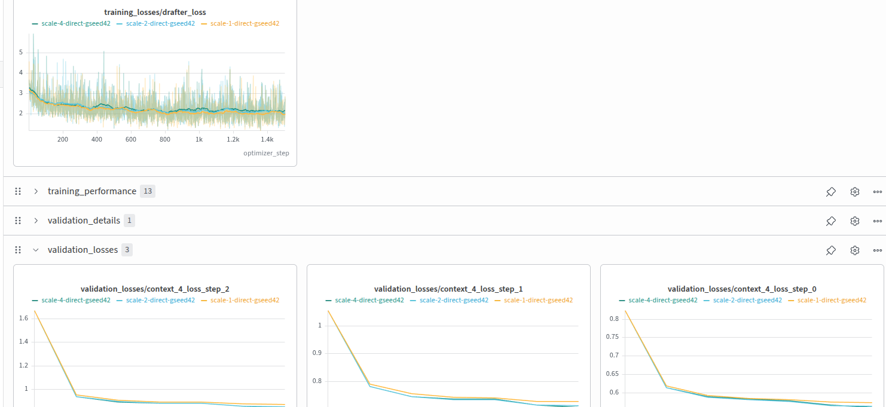
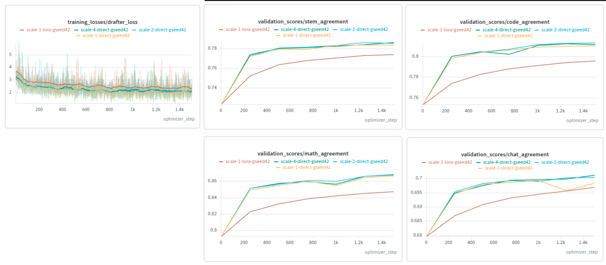

# GEN-001 — Direct generator training: data pool size

## Record

- Observation date: 2026-10-19
- Status: preliminary; one seed and visual comparison of W&B curves.
- Evidence: two user-supplied screenshots preserved below; raw metric exports
  and exact run URLs were not supplied with this observation.
- Setup reference: [online campaign runbook](../eagle3_generator_campaign_online.md)
  and [campaign configuration](../../../examples/eagle3-lora/generator_campaign_online.yaml).
  These are current repository references, not archived configurations of the measured runs.

## Question

Does increasing the direct generator's training pool improve validation
performance when the optimizer-update budget is held constant?

## Setup

| W&B run name | Subsets per domain | Training examples | Optimizer updates | Seed |
| --- | --- | --- | --- | --- |
| `scale-1-direct-gseed42` | `00000` | 4,000 | 1,500 | 42 |
| `scale-2-direct-gseed42` | `00000`–`00001` | 8,000 | 1,500 | 42 |
| `scale-4-direct-gseed42` | `00000`–`00003` | 16,000 | 1,500 | 42 |

All pools include math, code, stem, and chat, with 1,000 training examples per
domain subset. The pools are nested. Each arm starts with a fresh conditional
generator, without LoRA-bank reconstruction or warmup.

The configured shared recipe uses frozen Qwen3-8B target states and an EAGLE3
drafter, `last` conditioning, `lk_hybrid` loss, four episodes per update, sampled
training context sizes 1–8, and an 8,192-token microbatch budget. AdamW uses
learning rate 1e-4, weight decay 0.01, gradient clipping 0.85, and 100 learning-rate
warmup updates. Activations are generated online and cached in CPU RAM. The
intended hardware is an A100 80 GB.

This holds update count constant; it does not hold epochs constant or guarantee
equal processed tokens or wall time. Larger pools receive less average reuse
within this budget. The learning-rate warmup is unrelated to the retired bank warmup.

Validation uses the held-out validation rows of subset `00000` in each domain
(100 rows per domain), grouped into context-4 episodes, at updates 0, 250,
500, 750, 1,000, 1,250, and 1,500. These are separate rows from training, but
their subset identity is represented in every training arm.

## Evidence and observations

- Overall agreement and the displayed domain and context-step agreement curves
  closely track each other. The largest gain occurs in the first 250 updates;
  subsequent gains are smaller across all three arms.
- At the end of training, overall agreement is approximately 0.79 for all arms.
  Differences appear to be a few tenths of a percentage point, with a slight
  advantage for the larger pools in some curves. These are visual readings,
  not exported measurements or an established ranking.
- The displayed context-step validation losses also closely overlap. Smoothed
  training losses follow similar trajectories despite substantial per-update noise.
- The agreement-versus-training-seconds panel shows no clear large separation
  among the arms. It does not establish equal compute cost or serving throughput.

These metrics measure offline drafter/target agreement and training losses.
They do not measure actual speculative decoding acceptance, accepted draft length,
latency, or throughput from a serving benchmark.

## Interpretation and limits

**For this validation split, seed, recipe, and 1,500-update budget, increasing
the training pool from 4K to 16K examples has a small observed effect relative
to the improvement produced by training itself.**

This supports limited sensitivity to training pool size under the measured
conditions. It does not establish that data quantity is generally unimportant:

- There is only one seed per arm; no variance estimate, significance test, or
  equivalence margin is available.
- Validation covers one subset per domain, represented in all training pools.
  Results on additional subset distributions could differ.
- A fixed update budget can limit the benefit of more data. Longer training or
  comparisons at matched epochs could yield different results.
- Exact run IDs, immutable effective configurations, training code revisions,
  checkpoint hashes, and raw metric exports remain unrecorded here. The shared
  recipe above reflects the repository setup; run artifacts must confirm it.

## Decision and next check

Treat 4K training as a reasonable economical baseline for this validation
workload. The current evidence alone does not justify additional larger-pool
training or selecting a statistically superior arm.

Compare the existing checkpoints with the same correctness-checked
[HTTP/GuideLLM workflow](../eagle3_generator_http.md). Report current subset
`00000` separately from subsets `00002`–`00005`, and label which subsets each
arm saw during training: `00002`–`00003` are seen by scale-4, while `00004`–`00005`
are unseen by all three scaling arms. Use actual serving acceptance and timing
before drawing deployment conclusions. This is a proposed follow-up, not a
completed benchmark.

## Updates

- 2026-10-19: Initial qualitative result recorded from supplied W&B screenshots.

### 2026-10-23 — Ordinary LoRA included in the scaling comparison

The newly supplied composite includes `scale-1-lora-gseed42` alongside all three
generator scales. The intended baseline is ordinary LoRA on the 4K pool at the
same 1,500-update budget; historical resolved configs remain unavailable to
verify every matched setting. Generator agreement curves still largely overlap.
Ordinary LoRA improves more slowly and finishes visibly lower on math, code,
and STEM; the chat gap is smaller. Training loss is noisy, with lower final
generator trends. These are qualitative readings, not new exported measurements.

The observation supports limited sensitivity to pool size **at this update
budget and on this split**, rather than a general claim that data quantity is
unimportant. Epochs, processed tokens, compute, and wall time are not matched.
The generator has substantially more trainable parameters than ordinary LoRA,
so this comparison does not isolate conditioning from model capacity.
This is a training ablation; it does not restore the retired scale-1 generator
row to the current four-model serving comparison.
