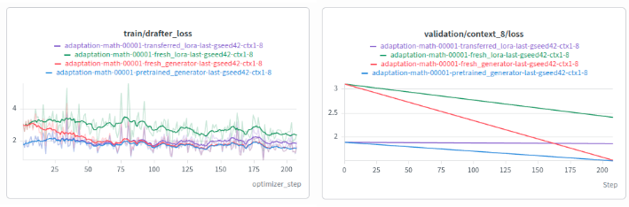

# GEN-004 — Bank warmup, adaptation, and the direct-training decision

## Record

- Evidence received: 2026-10-23; exact run execution date unavailable.
- Status: preliminary visual observation; bank-based workflow retired.
- Protocol reference: [historical adaptation notes](../eagle3_generator.md#preliminary-adaptation-observations-2026-10-07).
- Evidence: supplied W&B screenshot, without raw metric exports or immutable run configs.

## Question and setup

Does bank reconstruction warmup provide a lasting benefit over optimizing a
fresh generator on the original examples?

The historical protocol compares a bank-pretrained generator, a fresh generator,
a transferred ordinary LoRA, and a fresh ordinary LoRA on `math-00001`.
It records seed 42, last-token conditioning, training context sizes 1–8, one
adaptation epoch, and context-8 validation. The newly supplied plot spans roughly
200 updates. Both generators learn through the drafter loss during adaptation.
An ordinary LoRA learns one persistent adapter; a generator emits an adapter
for each conditioning group.

## Evidence and observations

- The pretrained generator starts with lower validation loss.
- The fresh generator catches up to a similar final validation loss.
- The transferred ordinary LoRA changes little; the fresh ordinary LoRA improves
  but ends above both generators in the displayed validation panel.

These are qualitative observations. The new image's endpoint scale differs from
the earlier screenshot transcription in the historical notes. Those earlier
approximate numbers are not reused here; raw exports are needed to reconcile
which evaluation/run each screenshot represents.

## Decision

**Retire bank-based generator warmup. Train directly on the original examples
using the drafting loss.** The bank route first converts examples into trained
LoRA factors, then trains the generator to reproduce that proxy. Direct training
optimizes the drafting objective itself and removes bank construction and
reconstruction stages. The lack of an observed final-loss benefit from bank
warmup supports this simpler workflow. No further bank experiments are planned.

## Limits

This does not show that warmup has no initialization benefit: it does in the
supplied curves. Nor is it a matched-total-compute comparison of bank warmup
versus direct pretraining on exactly the same examples. The roughly 293M-parameter
generator has much more trainable capacity than ordinary rank-32 LoRA. The study
has one seed, missing run provenance, and no independent serving acceptance or
throughput measurement. The historical notes also identify reuse of validation
for conditioning selection. The decision is specific to our workflow; universal
bank uselessness or strict direct-training superiority is not established.

## Updates

- 2026-10-23: New adaptation image archived; observations and retirement decision
  recorded separately from the earlier approximate numerical transcription.
